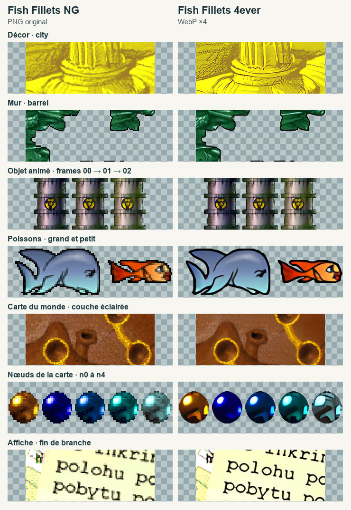

# Import des images ×4 de Fish Fillets 4ever

Le 21 novembre 2026, **2 701 images ×4** ont été associées à leurs PNG dans `images/`. Elles couvrent **71 niveaux**, les deux poissons, sept images de carte et d’interface, neuf affiches et deux éléments de la cinématique de la mallette. Le manifeste contient aussi les 449 images placées en quarantaine et les 87 agrandissements au plus proche voisin écartés. [Manifeste par fichier](ff4e-upscales.json)

## Provenance

| Dépôt | Révision |
|---|---|
| Source | [ff4e/ff4e.github.io à 492dfd02a9f413e00a27b40d22d960732e931f78](https://github.com/ff4e/ff4e.github.io/tree/492dfd02a9f413e00a27b40d22d960732e931f78) |
| Destination de départ | [debovitch/fillets-data à 7daaf56dc85500135588037c0bbbb0870b92ec6d](https://github.com/debovitch/fillets-data/tree/7daaf56dc85500135588037c0bbbb0870b92ec6d) |

ALTAR interactive a créé le jeu de 1998. Fish Fillets NG a fourni les graphismes de référence. Fish Fillets 4ever crédite Martin Obrátil pour le port web et l’upscale. La GPL v2 accompagne les images de cet import. Le code du port web est publié sous GPL-2.0-or-later. [Crédits, notices et licence](../CREDITS.md) · [Inventaire des transformations amont](https://github.com/ff4e/ff4e.github.io/blob/492dfd02a9f413e00a27b40d22d960732e931f78/ASSETS.md)

Le studio de ff4e choisit le modèle par image. Les empreintes de construction identifient notamment Real-CUGAN, des variantes de Real-ESRGAN dont General WDN, les modèles d’illustration et APISR pour les cinq nœuds. Le pipeline de traitement des sprites propage les couleurs sous l’alpha et traite la silhouette séparément pour limiter les franges. Les fichiers livrés conservent les choix amont, y compris les contours redessinés. [Construction des salles](https://github.com/ff4e/ff4e.github.io/blob/492dfd02a9f413e00a27b40d22d960732e931f78/tools/build-room-ai.mjs) · [Construction des fichiers distribués](https://github.com/ff4e/ff4e.github.io/blob/492dfd02a9f413e00a27b40d22d960732e931f78/tools/studio/build-ai.mjs) · [Modèles et traitement des contours](https://github.com/ff4e/ff4e.github.io/blob/492dfd02a9f413e00a27b40d22d960732e931f78/tools/studio/lib/upscale.mjs)

## Méthode

1. L’inventaire parcourt les 72 dossiers de salles et les six dossiers spéciaux de `public/enhanced-ai/`. Il inclut également les dix images `*_ai` du menu référencées par le pipeline de carte. Les masters de `public/enhanced/` servent exclusivement à identifier les correspondances.
2. Le script applique la table TSV puis les deux tables de correction de `tools/lib/ffngCodename.ts` selon leur priorité amont. Ainsi `PRVNI` utilise `start` et `ZAVER` utilise `ending`, même si plusieurs PNG des deux salles sont identiques.
3. Pour chaque décor et mur, `createRoom` et `addItemAnim(room,…)` confirment la première frame dans le Lua NG. Le script exige ensuite un unique PNG de même SHA-256 que le master dans cette salle. Cela résout aussi les trois couples de couches de `STEEL`. Pour les objets, les deux copies d’`objects.json` et `ai.json` doivent s’accorder sur chaque identifiant et chaque frame ordonnée. Chaque PNG nommé doit être identique au master dans le dossier de la salle. Un sprite partagé conserve plusieurs associations.
4. Pour les poissons, le manifeste de chaque taille et orientation distingue le corps des têtes sous `heads/`. Chaque fichier a été comparé au PNG NG exact. Les affiches, la base de la mallette et les composants de la carte ont été comparés pixel par pixel après normalisation de l’alpha. Les pixels RGB invisibles sous alpha nul sont ignorés lors de cette recherche. La première frame opaque de la mallette est identifiée par le Lua, l’ordre de lecture et la comparaison visuelle.
5. Les WebP compatibles sont copiés octet pour octet à côté des PNG. Cinq nœuds de carte sont déjà upscalés à la source mais fournis en PNG. Leur encodage en WebP sans perte conserve **chaque valeur RGBA**, y compris sous alpha nul. Les autres ressources IA sont copiées telles quelles sous `quarantine/ff4e/<chemin source>`. La destination refuse tout écrasement différent, indépendamment de la qualité supposée du fichier local.

### Rejouer l’import

Dans un checkout de cette branche, avec Python et Pillow compilé avec WebP, utiliser le script ci-dessous. L’environnement de référence utilise Pillow 13.0.0 et libwebp 1.6.0. Ces versions permettent de reproduire les empreintes des cinq encodages. Le reste du jeu fonctionne sans Python ni checkout de ff4e.

```sh
git clone --filter=blob:none --no-checkout https://github.com/ff4e/ff4e.github.io ../ff4e-source
git -C ../ff4e-source sparse-checkout set tools test/fixtures/solutions public/enhanced public/enhanced-ai public/data/Menu
git -C ../ff4e-source checkout --detach 492dfd02a9f413e00a27b40d22d960732e931f78
python3 tools/import-ff4e-upscales.py ../ff4e-source --dry-run
python3 tools/import-ff4e-upscales.py ../ff4e-source --apply
python3 tools/import-ff4e-upscales.py ../ff4e-source --dry-run --inventory > /tmp/ff4e-inventaire.json
```

Le dry-run recalcule les associations et vérifie le manifeste sans écrire dans le dépôt. Le mode apply vérifie toutes les destinations avant de publier les fichiers manquants. Un fichier manquant dans les sources, un conflit de hash ou une association incohérente renvoie un code non nul. Une interruption pendant la copie laisse uniquement des destinations complètes et la relance reprend les fichiers manquants. Le manifeste versionné permet d’inspecter le résultat hors ligne.

## Résultats

| Mesure | Résultat |
|---|---:|
| Images candidates sous `enhanced-ai` | 3 227 |
| Images candidates supplémentaires du menu | 10 |
| Total examiné | 3 237 |
| Importées dans `images/` | 2 701 |
| Conservées en quarantaine | 449 |
| Ignorées car agrandies au plus proche voisin | 87 |
| Déjà identiques au premier passage / remplacées | 0 / 0 |
| Affectations de niveau ambiguës parmi les images intégrées | 0 |
| Ressources IA sans équivalent PNG directement utilisable | 449 |
| Taille des WebP intégrés | 103 147 088 octets (98,37 Mio) |
| Taille de la quarantaine | 54 660 684 octets (52,13 Mio) |
| Plus gros fichier image livré | 3 426 980 octets (`WARCR2/p.webp`) |

| Type intégré | Nombre |
|---|---:|
| Décors, frames animées comprises | 71 |
| Murs, frames animées comprises | 70 |
| Sprites d’objets | 2 410 |
| Corps et têtes des poissons | 132 |
| Affiches de fin de branche | 9 |
| Carte éclairée, pédomètre et cinq nœuds | 7 |
| Fond et première frame de la mallette | 2 |

## Détail par niveau

Le tableau compte les fichiers physiques de chaque dossier **source**. Les affiches sont comptées dans `_story` et les poissons dans `_fish`. Une frame utilisée par plusieurs objets ne compte qu’une fois. La colonne « Hors IA » distingue les agrandissements au plus proche voisin. Le manifeste fournit tous les chemins individuels.

| Source ff4e | Dossier NG | Candidates | Intégrées | Quarantaine | Hors IA |
|---|---|---:|---:|---:|---:|
| `BANKA` | experiments | 188 | 188 | 0 | 0 |
| `BARELY` | barrel | 136 | 136 | 0 | 0 |
| `BATHROOM` | bathroom | 33 | 33 | 0 | 0 |
| `BATYSKAF` | bathyscaph | 20 | 20 | 0 | 0 |
| `BLUDISTE` | labyrinth | 8 | 8 | 0 | 0 |
| `BOTTLES` | aztec | 30 | 30 | 0 | 0 |
| `CHODBA` | corridor | 41 | 41 | 0 | 0 |
| `DELA` | cannons | 16 | 16 | 0 | 0 |
| `DEUTSCHE` | elk | 19 | 19 | 0 | 0 |
| `DIRY` | pavement | 55 | 55 | 0 | 0 |
| `DISKETA` | floppy | 33 | 33 | 0 | 0 |
| `DRAKAR` | viking2 | 51 | 51 | 0 | 0 |
| `DRAKAR1` | viking1 | 37 | 37 | 0 | 0 |
| `GRAL` | grail | 27 | 27 | 0 | 0 |
| `JEDNICKY` | pearls | 19 | 19 | 0 | 0 |
| `JESKYNE` | cave | 36 | 36 | 0 | 0 |
| `KAJUTA1` | cabin1 | 18 | 18 | 0 | 0 |
| `KAJUTA2` | cabin2 | 28 | 28 | 0 | 0 |
| `KANKAN` | cancan | 66 | 66 | 0 | 0 |
| `KNIHOVNA` | alibaba | 73 | 73 | 0 | 0 |
| `KORALY` | creatures | 52 | 52 | 0 | 0 |
| `KOSTE` | broom | 15 | 15 | 0 | 0 |
| `KUCHYNE` | kitchen | 21 | 21 | 0 | 0 |
| `KUFRIK` | briefcase | 20 | 20 | 0 | 0 |
| `LETADLO` | airplane | 14 | 14 | 0 | 0 |
| `LODE` | gods | 112 | 112 | 0 | 0 |
| `MAPA` | map | 32 | 32 | 0 | 0 |
| `MIKRO` | society | 38 | 38 | 0 | 0 |
| `MOTOR` | engine | 12 | 12 | 0 | 0 |
| `NCP` | imprisoned | 34 | 34 | 0 | 0 |
| `NOGROUND` | noground | 7 | 7 | 0 | 0 |
| `ODPADKY` | duckie | 10 | 10 | 0 | 0 |
| `PAPRSKY` | magnet | 21 | 21 | 0 | 0 |
| `PARTY1` | party1 | 76 | 76 | 0 | 0 |
| `PARTY2` | party2 | 94 | 94 | 0 | 0 |
| `POCITAC` | computer | 11 | 11 | 0 | 0 |
| `POHON` | propulsion | 57 | 57 | 0 | 0 |
| `POTOPENA` | wreck | 14 | 14 | 0 | 0 |
| `PRAVIDLA` | cellar | 21 | 21 | 0 | 0 |
| `PRVNI` | start | 15 | 15 | 0 | 0 |
| `PUCLIK` | puzzle | 128 | 128 | 0 | 0 |
| `PUZZLE` | hardware | 19 | 19 | 0 | 0 |
| `PYRAMIDA` | pyramid | 26 | 26 | 0 | 0 |
| `REAKTOR` | reactor | 41 | 41 | 0 | 0 |
| `RECYCLED` | corals | 16 | 16 | 0 | 0 |
| `SCHODY` | stairs | 57 | 57 | 0 | 0 |
| `SCORE` | score | 2 | 0 | 0 | 2 |
| `SECRET` | crabshow | 63 | 63 | 0 | 0 |
| `SLOUPY` | columns | 29 | 29 | 0 | 0 |
| `SMETAK` | dump | 47 | 47 | 0 | 0 |
| `SPUNT` | atlantis | 28 | 28 | 0 | 0 |
| `STEEL` | steel | 30 | 30 | 0 | 0 |
| `SVATBA` | tank | 16 | 16 | 0 | 0 |
| `TETRIS` | tetris | 15 | 4 | 0 | 11 |
| `TRUHLA` | chest | 51 | 51 | 0 | 0 |
| `TRUP` | snowman | 8 | 8 | 0 | 0 |
| `UFO` | ufo | 19 | 19 | 0 | 0 |
| `UTES` | reef | 16 | 16 | 0 | 0 |
| `VES` | music | 49 | 49 | 0 | 0 |
| `VITEJTE1` | city | 42 | 42 | 0 | 0 |
| `VLADOVA` | captain | 47 | 47 | 0 | 0 |
| `VRAK` | library | 15 | 15 | 0 | 0 |
| `WARCR2` | warcraft | 13 | 1 | 0 | 12 |
| `WC` | wc | 6 | 6 | 0 | 0 |
| `WIN` | windoze | 44 | 2 | 0 | 42 |
| `ZAVAL` | gems | 26 | 26 | 0 | 0 |
| `ZAVER` | ending | 20 | 20 | 0 | 0 |
| `ZDVIZ1` | elevator1 | 18 | 18 | 0 | 0 |
| `ZDVIZ2` | elevator2 | 18 | 18 | 0 | 0 |
| `ZELVA` | turtle | 76 | 76 | 0 | 0 |
| `ZRC` | submarine | 15 | 15 | 0 | 0 |
| `ZX` | emulator | 28 | 8 | 0 | 20 |
| `_credits` | — | 2 | 0 | 2 | 0 |
| `_desky` | — | 144 | 0 | 144 | 0 |
| `_fish` | fishes | 132 | 132 | 0 | 0 |
| `_kufr` | demo_briefcase | 285 | 2 | 283 | 0 |
| `_menu` | menu | 10 | 7 | 3 | 0 |
| `_panel` | — | 17 | 0 | 17 | 0 |
| `_story` | 9 dossiers (poster.png) | 9 | 9 | 0 | 0 |
| **Total** | | **3 237** | **2 701** | **449** | **87** |

Dix autres dossiers de niveaux NG ont **zéro image candidate** dans cette révision de ff4e, à savoir `electromagnet`, `fdto`, `hanoi`, `hole`, `key`, `keys`, `linux`, `nowall`, `rotate` et `rush`. Leurs PNG restent disponibles.

## Problèmes rencontrés

- **Séquence de la mallette.** Le Lua NG affiche une image opaque puis applique des deltas transparents à (135, 25). ff4e fournit des régions de 380 × 285 entièrement recomposées, agrandies à 1 520 × 1 140. La base et `f0000` correspondent à deux PNG directement utilisables. Parmi les autres fichiers, 282 sont des composites incompatibles avec les deltas et `f0284.webp` figure dans la liste des fichiers sans occurrence dans l’ordre de lecture. Ils restent en quarantaine. Le manifeste amont prévoit explicitement la frame native `f0056`, sans WebP. Les répétitions et positions figurent dans le champ `playback`.
- **Carte du monde.** La couche éclairée correspond exactement à `map_lower.png` au format natif. Sur la couche sombre, 5,75 % des pixels du master divergent de `map.png` dans le secteur inférieur droit (x 371–620, y 220–479). Intégrer `mapa-0_ai.webp` effacerait du dessin propre à NG. Elle reste disponible en quarantaine avec la planche d’icônes `ikonky_ai.webp` et le parchemin `loading_ai.webp`, qui n’ont pas de PNG autonome correspondant. Les versions localisées de la carte conservent leur propre image.
- **Interface.** Les 144 plaques `_desky` contiennent des noms de niveaux dessinés en anglais ou en tchèque et des fragments du fond. Les 17 éléments `_panel` appartiennent au panneau du port. Les deux couches `_credits` utilisent une fenêtre et un générique déroulant différents. Le master de la bande mesure 640 × 3 285 contre 640 × 3 800 pour le PNG NG. La recherche parmi les 3 780 PNG d’`images/` n’a trouvé aucun master visuellement identique pour ces trois groupes.
- **Agrandissements sans IA.** Les stamps classent 85 fichiers de `TETRIS`, `WARCR2`, `WIN` et `ZX` sous le modèle `orig`. Les deux couches de `SCORE` ont été produites par réplication de pixels depuis le FFR. Ces 87 fichiers sont inventoriés et leurs chemins sont récupérables au commit source.
- **Cadrage et contours.** Douze listes d’objets ont des dimensions qui varient déjà entre frames dans les PNG natifs, dans `cave`, `cancan`, `creatures`, `gods`, `imprisoned` et `snowman`. Chaque frame a été vérifiée contre ses propres dimensions. Les poissons ont aussi des largeurs différentes dans certaines poses. Dans 76 variantes intégrées, le traitement amont introduit de l’alpha sur une image entièrement opaque. Les extrema avant/après sont enregistrés. Cinq images transparentes vides, dont quatre têtes de poisson, restent vides dans les deux versions.

## Validation

- Les **3 150 WebP livrés** ont tous été relus depuis leur destination et entièrement décodés. Dimensions, alpha et SHA-256 ont été vérifiés. Pour 3 145 fichiers, les octets sont identiques à la source. Pour les cinq PNG upscalés des nœuds, la vérification porte également sur tous les pixels RGBA après décodage du WebP.
- Les **3 787 PNG d’origine** (3 780 sous `images/`, sept dans la documentation) sont identiques aux blobs Git de la base. Le diff des fichiers Lua, RUM et du texte de licence est vide.
- Les deux manifests d’objets et le manifeste IA concordent sur **1 301 listes de frames**. Les index sont continus pour chacune. Chaque liste d’objets est entièrement fournie en IA ou entièrement classée au plus proche voisin. La vérification couvre aussi les listes gauche/droite des deux poissons et les trois frames synchronisées des décors et murs de `STEEL`.
- Le premier dry-run a annoncé **3 150** écritures et la première application en a effectué autant. La seconde application a reconnu **3 150 fichiers identiques** et en a écrit **zéro**. Deux essais sur copie isolée ont provoqué les échecs attendus avec un WebP concurrent différent et un PNG original manquant. Aucun fichier de cette copie n’a été publié ou écrasé lors de ces échecs.
- Le contrôle visuel a porté sur le décor de `city`, les contours et ouvertures du mur de `barrel`, trois frames du tonneau, les deux poissons, la couche éclairée de la carte, les cinq nœuds et une affiche. Cadrage et transparence correspondent sur cet échantillon. Les contours fins sont lissés et certains détails redessinés, particulièrement sur les sprites de quelques pixels. Le contrôle visuel est un échantillonnage. La validation porte sur les données et ne comprend aucune exécution du moteur Flutter.



## Intégration Flutter

Utiliser les entrées `status == "integrated"`, indexées par le chemin `original`. Charger `destination` en texture et tracer l’intégralité de ses pixels dans le rectangle habituellement utilisé pour le PNG. La taille logique de chaque frame est `logical` et sa résolution physique est `pixels`. Par exemple, le tonneau `barel_00` occupe toujours **135 × 195** en unités d’image NG pour une texture de **540 × 780**. Avec `Canvas.drawImageRect`, le rectangle source couvre 540 × 780 pixels et le rectangle destination garde la position, la taille et le zoom du jeu. Les offsets, la grille, les collisions et les masques de carte restent définis par les données d’origine.

Pour les sprites, `bindings` conserve les couples `[identifiant d’objet ff4e, index de frame]` à l’intérieur du niveau. Pour les couches animées, `frame` conserve l’index. Garder les offsets de chaque frame, les poses, les têtes superposées et le repli sur le PNG exact si la variante manque, y compris pour les localisations. Les masques d’index et de collisions doivent continuer à utiliser les ressources natives. Exclure `quarantine/` de la liste d’assets embarqués.

## Suites possibles

Une future passe peut adapter la carte sombre en conservant les détails NG, ou reconstruire la séquence complète de la mallette avec un contrat de rendu explicite pour les deltas. Les vidéos améliorées `public/data/Movie/intro_ai.mp4` et `logo_ai.mp4` existent au commit source. Cet import porte uniquement sur les images fixes et les sprites. [Vidéos à la révision examinée](https://github.com/ff4e/ff4e.github.io/tree/492dfd02a9f413e00a27b40d22d960732e931f78/public/data/Movie)
